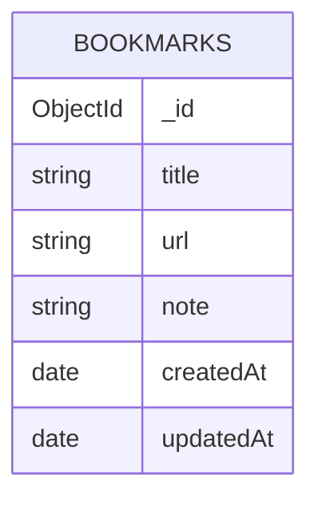

# EDD.md

## Overview

This EDD documents the MongoDB data model for the **Bookmarks** app
(single-page Next.js App Router + MongoDB application).

- Client source of truth: `lib/mongodb.ts`
- Data access source of truth: `db/bookmarks.ts`
- Application validation source of truth: `lib/bookmark-validation.ts`
- Application name (connection metadata): `devrel-tutorial-javascript-nextjstemplate`
- Database: `bookmark_app`, selected by the database path in `MONGODB_URI`; the client uses `client.db()` rather than hardcoding the name.

The app uses one shared `bookmarks` collection. It has no application sign-in
or per-user isolation: visitors authorized by the deployment platform can
read and change the same records. The deployment platform is responsible for
restricting access.

Validation is enforced **in application code** (`lib/bookmark-validation.ts`).
There is **no JSON schema validation** on the collection itself; the server
data layer (`db/bookmarks.ts`) only writes fixed, validated fields.

## Entities

### Bookmark

Collection: `bookmarks`

| Field | BSON Type | Required | Constraints | Description |
| --- | --- | --- | --- | --- |
| `_id` | `ObjectId` | No | Generated by the MongoDB driver | Primary key. Updates and deletes target an exact `_id`; the string form is validated as exactly 24 hex characters before conversion to `ObjectId` |
| `title` | `string` | Yes | Trimmed, 1–120 characters | Display name; rendered as the text of an external link |
| `url` | `string` | Yes | Trimmed, 1–2048 characters; absolute `http`/`https` URL with a hostname and no username/password | Rendered as the external link `href` (opens with `rel="noopener noreferrer"`) |
| `note` | `string` | Yes | Trimmed, 0–1000 characters; an empty string is persisted when blank | Plain-text note, rendered as text (never HTML) |
| `createdAt` | `date` | Yes | Server-generated on insert, never modified afterwards | Sort key for the newest-first list |
| `updatedAt` | `date` | Yes | Server-generated on insert and on every successful update | Shown as "Updated" on the item |

Allowed write fields are fixed to `title`, `url`, `note` plus the
server-generated timestamps; clients can never set `_id` or the timestamps.

## Operations

| Operation | Query / Command | Notes |
| --- | --- | --- |
| List | `find(filter).sort({ createdAt: -1, _id: -1 }).limit(101)` | Displays at most 100 records. The extra record signals an older page. A validated cursor filters to an earlier `createdAt` or the same timestamp with a smaller `_id`; invalid cursors fall back to the newest page. |
| Create | `insertOne` | Server sets `createdAt`/`updatedAt` to the same instant |
| Update | `updateOne({ _id }, { $set: { title, url, note, updatedAt } })` | `createdAt` is preserved; stale ids (record already deleted) return no match |
| Delete | `deleteOne({ _id })` | Exact `_id` targeting; returns whether a document was deleted |

All mutation ids are validated with `isBookmarkId` (exactly 24 hex characters)
before `ObjectId` construction, and form payloads are re-validated by the
server actions in `app/actions.ts` before the data layer is called.

## Mermaid Diagram

## Access and operation constraints

- **Shared data**: one global collection, no user ownership field. All
  authorized visitors see and modify the same bookmarks.
- **Pagination**: queries fetch at most 101 records and display 100. Timestamp/ID cursors are validated before database filters are built. “Older bookmarks” advances through records and “Back to newest” returns to the first page.
- **Index setup**: `npm run db:setup` creates `bookmarks_newest_first` on `{ createdAt: -1, _id: -1 }`. Run it for each target database before deployment; the application does not create indexes during requests. The verification harness creates it on its disposable database.
- **Connection behavior**: `lib/mongodb.ts` sets
  `serverSelectionTimeoutMS: 5000` for bounded feedback when the database is
  unavailable — a UX bound for this small interactive demo, not a performance
  claim. The client is created lazily (nothing connects at import time or
  during static builds), cached in development on `globalThis` and per module
  in production, and a rejected connection clears the cached promise so a
  later request can retry.
- **No schema enforcement in the database**: keep application validation and
  the EDD contract in sync if the fields ever change.
