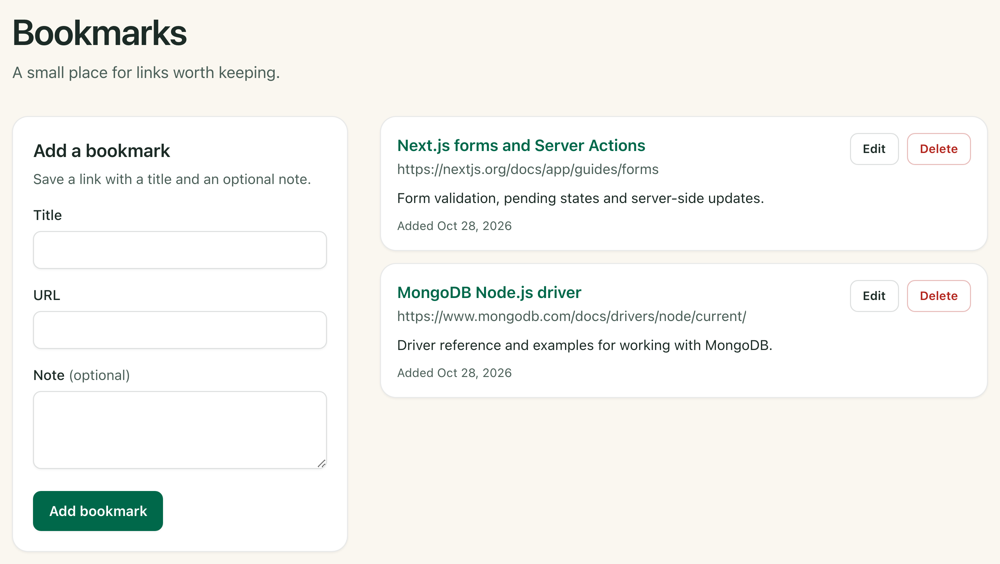
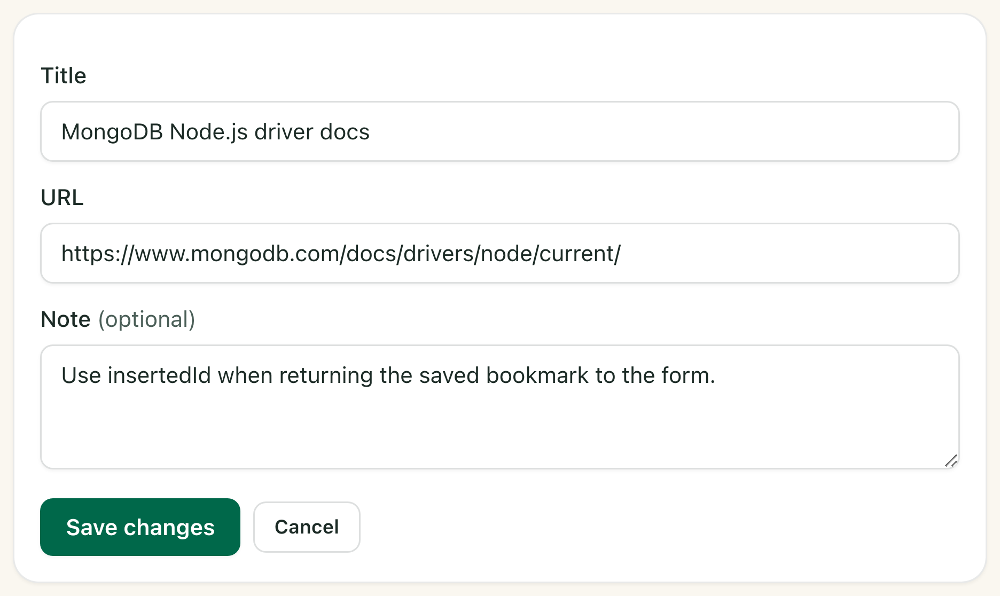

# Build a Bookmark App With Next.js and MongoDB

Closing a browser tab should be easy. Then you get to that tutorial with the code example you spent ages looking for. You don’t need it right now, but you’re not quite ready to lose it either. So it stays open. You could bookmark it, of course. But when you come back a few weeks later, will you remember which part you wanted to use?

Let’s build a Next.js app for those links, with MongoDB storing the bookmarks. You can leave yourself a note, like “Try this connection example in my next project.” We’ll also add ways to edit a bookmark’s details or delete it when you no longer need it.

## What we’re building

One page, a few fields, and somewhere to put those links. Each bookmark has a title, URL and optional note. You can edit it in place, cancel a deletion, or confirm that you’re done with it. The finished list also lets you browse older bookmarks, 100 at a time. We’ll also add browser tests and deploy the app to Vercel.



We’ll start with [MongoDB’s Next.js template](https://github.com/mongodb-developer/nextjs-template-mongodb). The [finished project](https://github.com/Eronmmer/mongodb-bookmarks-tutorial/tree/c07959c5b7f6d333a7e0c5ce7a8b0433c13e9d22) contains the complete source. We’ll write the core database operations here and link to longer supporting files when we need them.

This version has one bookmark list and no application sign-in. Anyone with access to the app can read and change that list. We’ll keep the hosted app behind Vercel’s access controls and use public example links while building.

## Before you start

You’ll need basic TypeScript and some experience with React components, props and forms. We’ll explain the Next.js server conventions and MongoDB operations as we use them. The commands below use a macOS or Linux shell.

The main walkthrough uses your computer and MongoDB Atlas. If you prefer a browser editor, follow the Codespaces option below, then rejoin the same build. A temporary local database is also available if you want to try the app before setting up Atlas.

Atlas keeps your bookmarks after you stop the app, and we’ll use it for deployment.

## Open the MongoDB template

### On your computer

Make sure you have [Git](https://git-scm.com/downloads) and [Node.js 24 LTS](https://nodejs.org/en/download) installed, then clone the template. This tutorial was tested with Node.js 24.22.2:

```bash
git clone https://github.com/mongodb-developer/nextjs-template-mongodb.git bookmarks-build
cd bookmarks-build
git switch -c bookmarks 09278fa9369ce03c3e988156351655f87317ecf6
```

The long commit ID selects the template revision used to test this tutorial. That gives us the same starting files even if the template changes later. `bookmarks` is simply the name of your working branch. The companion-file links also select tested revisions. When a step asks you to copy a file, open its link, choose **Raw**, and save the complete contents at the stated path. If the file belongs in a folder you don’t have yet, create that folder before saving it.

### Or use GitHub Codespaces

Before creating a Codespace, check your account’s included allowance and spending settings if you need to stay within the free allowance. Then open the [official template repository](https://github.com/mongodb-developer/nextjs-template-mongodb) and choose **Code → Codespaces → Create codespace**. Select the 2-core machine.

In the Codespace terminal, fetch the repository before switching to the tutorial commit. A prebuilt Codespace may start from an older revision:

```bash
git fetch origin
git switch -c bookmarks 09278fa9369ce03c3e988156351655f87317ecf6
```

Replace `.devcontainer/devcontainer.json` with the [companion configuration](https://github.com/Eronmmer/mongodb-bookmarks-tutorial/blob/c07959c5b7f6d333a7e0c5ce7a8b0433c13e9d22/.devcontainer/devcontainer.json) (in the final article, replace this link w the appropriate link to the correct file in the public repo we decide to go with). It selects Debian Bookworm with Node 24 and forwards port 3000. Choose **Codespaces: Rebuild Container** from the Command Palette, then wait for the rebuild before continuing.

From here, both routes use the same commands in the project terminal. In Codespaces, open the running app through port 3000 in the **Ports** panel and leave its visibility set to **Private**. On your computer, use `http://127.0.0.1:3000`.

## Install the dependencies

The template includes Next.js, React, TypeScript, Tailwind CSS, the MongoDB driver and Playwright. We’ll update its older packages and add two helpers for this app.

Set `.nvmrc` to Node 24 so [nvm](https://github.com/nvm-sh/nvm#installing-and-updating) can install the latest patch in that LTS release. If you already manage Node another way, skip the nvm commands and check that `node --version` reports a Node 24 release.

```bash
printf '24\n' > .nvmrc
nvm install
nvm use
node --version
```

The commands below stay within the major versions this tutorial uses. `server-only` catches accidental imports of database code into the browser, and `mongodb-memory-server-core` starts a temporary database for local development and tests.

```bash
npm install next@16 react@19 react-dom@19 mongodb@7 server-only
npm install --save-dev @playwright/test@1 \
  mongodb-memory-server-core@11 eslint-config-next@16
npm update
npm pkg set 'engines.node=24.x'
```

Keep `package.json` and `package-lock.json` in Git. The lockfile records the versions npm installed. Use `npm ci` when setting up another copy of your project. [`npm update`](https://docs.npmjs.com/cli/v11/commands/npm-update/) refreshes the template’s remaining dependencies within their allowed ranges.

Add commands for the database helpers and create their directory. We’ll add the helper files when we use them:

```bash
mkdir -p scripts
npm pkg set \
  'scripts.db:local=node scripts/local-db.mjs' \
  'scripts.db:setup=node --env-file-if-exists=.env scripts/setup-db.mjs'
```

Replace `.env.example` with this local connection setting:

`.env.example`

```bash
MONGODB_URI=mongodb://127.0.0.1:27028/bookmark_app
```

That example has no password. Replace the template’s `.env` entry in `.gitignore` with these two lines, then copy `.env.example` to `.env`:

`.gitignore`

```bash
.env*
!.env.example
```

```bash
cp .env.example .env
```

## Connect the starter to MongoDB

### Use MongoDB Atlas

[Create an Atlas account](https://www.mongodb.com/cloud/atlas/register?utm_campaign=devrel&utm_source=content&utm_medium=cta&utm_content=nextjs.template.example&utm_term=learning.fuel), then create or select a project and a Free cluster. Add a [database user](https://www.mongodb.com/docs/atlas/security-add-mongodb-users/) with `readWrite` access to `bookmark_app`. This is the identity the app connects as, separate from your Atlas sign-in account.

In [Network Access](https://www.mongodb.com/docs/atlas/security/ip-access-list/), allow the public outbound IP of the machine running Node.js. For local development, that is usually your computer’s public IP. For Codespaces, use the Codespace’s outbound IP and recheck it after a restart.

Choose [Connect → Drivers → Node.js](https://www.mongodb.com/docs/atlas/driver-connection/). Copy the `mongodb+srv://` URI into `MONGODB_URI` in `.env`, fill in the database username and password, and put `bookmark_app` between the final slash and the query string. Keep the options Atlas supplies. The database portion should read `/bookmark_app?`, followed by those options.

[Percent-encode reserved characters](https://www.mongodb.com/docs/manual/reference/connection-string-formats/) in the credentials. Keep `.env` out of Git, and keep the name `MONGODB_URI`. A [`NEXT_PUBLIC_` prefix](https://nextjs.org/docs/app/guides/environment-variables) would make a referenced value available to browser code.

### Or run a temporary database

For this option, leave `.env` set to `mongodb://127.0.0.1:27028/bookmark_app` and copy [scripts/local-db.mjs](https://github.com/Eronmmer/mongodb-bookmarks-tutorial/blob/c07959c5b7f6d333a7e0c5ce7a8b0433c13e9d22/scripts/local-db.mjs) (replace with final, public link before publishing) into your project. It downloads and starts a real MongoDB 9.0 process on loopback port 27028. If that port is occupied, the helper stops instead of choosing another port.

```bash
nvm use
npm run db:local
```

Leave this terminal running. Open another terminal at the project root for the app, and run `nvm use` there too. Remember that **Ctrl+C in the database terminal deletes this session’s bookmarks**.

### Check the connection before building the form

In `lib/mongodb.ts`, replace the existing `appName` option with this value:

`lib/mongodb.ts`

```typescript
appName: "devrel-tutorial-javascript-nextjstemplate",
```

`appName` labels this client in MongoDB connection metadata and logs. This value identifies the tutorial. It does not name the database or change the website’s title. The database is still `bookmark_app`, selected by the URI.

Replace `app/layout.tsx` with the [bookmark layout](https://github.com/Eronmmer/mongodb-bookmarks-tutorial/blob/c07959c5b7f6d333a7e0c5ce7a8b0433c13e9d22/app/layout.tsx). It sets the page title and uses system fonts, removing the starter’s web-font download.

In `tailwind.config.ts`, replace the `sans` array inside `theme.extend.fontFamily` with the following line. Keep the `defaultTheme` import and the rest of the configuration:

`tailwind.config.ts`

```typescript
sans: [...defaultTheme.fontFamily.sans],
```

Replace `next.config.ts` with the [companion configuration](https://github.com/Eronmmer/mongodb-bookmarks-tutorial/blob/c07959c5b7f6d333a7e0c5ce7a8b0433c13e9d22/next.config.ts). It keeps this directory as the Turbopack root. In Codespaces development, it also handles the `localhost:3000` origin used by the development proxy. That origin exception does not apply in production.

Start Next.js:

```bash
nvm use
npm run dev -- --hostname 127.0.0.1
```

Open the starter page and look for **Database connected**. If you don’t see it, check the URI, database credentials and Atlas IP access list. If you’re using the temporary database, make sure it is still running. Restart Next.js after changing `.env`. Once the message appears, we know the app can reach MongoDB.

Stop Next.js with **Ctrl+C** once the connection works. Keep the temporary database running if you’re using it. We’ll restart the app when the first bookmark form and list are ready.

## Give a bookmark somewhere to live

Let’s use the MongoDB Node.js driver documentation for our first bookmark. Add a note about what you want to revisit: “Check how insertOne returns the new document’s ID.”

MongoDB stores that bookmark as a document in the `bookmarks` collection. Here’s an illustrative document in MongoDB Extended JSON. Your generated ID and timestamps will differ:

```json
{
  "_id": { "$oid": "690000000000000000000001" },
  "title": "MongoDB Node.js driver docs",
  "url": "https://www.mongodb.com/docs/drivers/node/current/",
  "note": "Check how insertOne returns the new document’s ID.",
  "createdAt": { "$date": "2026-10-30T10:00:00.000Z" },
  "updatedAt": { "$date": "2026-10-30T10:00:00.000Z" }
}
```

`_id` lets us tell bookmarks apart, even when they point to the same URL. We don’t supply one when saving a bookmark, so the MongoDB driver generates it.

Our code sets `createdAt` and `updatedAt` to the same server timestamp. Editing the note changes `updatedAt` but leaves `createdAt` alone so that an edit won’t send the bookmark back to the top of the list.

### Describe the values shared by the page and forms

Copy the complete [lib/bookmark-types.ts](https://github.com/Eronmmer/mongodb-bookmarks-tutorial/blob/c07959c5b7f6d333a7e0c5ce7a8b0433c13e9d22/lib/bookmark-types.ts) into your project. The two types below describe what we save and what the components receive:

`lib/bookmark-types.ts`

```typescript
export interface BookmarkInput {
  title: string;
  url: string;
  note: string;
}

export interface BookmarkView {
  id: string;
  title: string;
  url: string;
  note: string;
  createdAt: string;
  updatedAt: string;
}
```

`BookmarkView` uses strings for the ID and dates so those values can cross the server/client boundary. The same file defines `ActionState`, which carries submission feedback, field errors and the values someone entered. An unused note becomes an empty string.

### Check the actual submitted values

TypeScript helps us while writing the app, but a request can contain values that never passed through our form. We need to validate those values on the server before saving them.

Copy the complete [lib/bookmark-validation.ts](https://github.com/Eronmmer/mongodb-bookmarks-tutorial/blob/c07959c5b7f6d333a7e0c5ce7a8b0433c13e9d22/lib/bookmark-validation.ts) into your project. It checks the submitted types, trims text, and limits titles to 120 characters, URLs to 2,048 and notes to 1,000. Here is its URL check:

`lib/bookmark-validation.ts`

```typescript
function validateUrl(url: string): string | null {
  if (!/^https?:\/\//i.test(url)) {
    return "Enter an absolute http or https URL, for example https://example.com.";
  }
  let parsed: URL;
  try {
    parsed = new URL(url);
  } catch {
    return "Enter a valid URL, for example https://example.com.";
  }

  if (parsed.protocol !== "http:" && parsed.protocol !== "https:") {
    return "Only http and https URLs are supported.";
  }
  if (parsed.hostname.length === 0) {
    return "The URL must include a hostname.";
  }
  if (parsed.username !== "" || parsed.password !== "") {
    return "URLs with a username or password are not allowed.";
  }
  return null;
}
```

This check validates the address format. It doesn’t visit the page or tell us whether the destination is safe. We also validate each bookmark ID before constructing an `ObjectId` for an edit or deletion.

## Connect once and reuse the client

Saving a bookmark and reading the list both need MongoDB. They can share a client instead of creating one for every operation. Replace `lib/mongodb.ts` with this helper:

`lib/mongodb.ts`

```typescript
import "server-only";

import { MongoClient, type Db, type MongoClientOptions } from "mongodb";

const uri = process.env.MONGODB_URI;

const appName = "devrel-tutorial-javascript-nextjstemplate";

const serverSelectionTimeoutMS = 5000;

const options: MongoClientOptions = {
  appName,
  serverSelectionTimeoutMS,
};

let clientPromise: Promise<MongoClient> | null = null;

declare global {
  var _mongoClientPromise: Promise<MongoClient> | undefined;
}

export function getClient(): Promise<MongoClient> {
  if (!uri) {
    throw new Error(
      "MongoDB is not configured. Set the MONGODB_URI environment variable.",
    );
  }

  if (process.env.NODE_ENV === "development") {
    if (global._mongoClientPromise) {
      return global._mongoClientPromise;
    }
    clientPromise = new MongoClient(uri, options)
      .connect()
      .catch((error) => {
        global._mongoClientPromise = undefined;
        clientPromise = null;
        throw error;
      });
    global._mongoClientPromise = clientPromise;
    return clientPromise;
  }

  if (!clientPromise) {
    clientPromise = new MongoClient(uri, options)
      .connect()
      .catch((error) => {
        clientPromise = null;
        throw error;
      });
  }
  return clientPromise;
}

export async function getDatabase(): Promise<Db> {
  const client = await getClient();
  return client.db();
}
```

`getClient()` connects on first use and keeps the promise for later calls. In development, storing it on `globalThis` lets it survive hot reloads. In production, the module keeps it for that running server instance. Each `MongoClient` manages its own [connection pools](https://www.mongodb.com/docs/drivers/node/current/connect/connection-options/connection-pools/), so we keep the client open. If the initial connection fails, we clear the promise so a later call can try again.

`serverSelectionTimeoutMS` gives the driver five seconds to select a database server. It does not time out the whole HTTP request. We leave connection-pool sizes at the driver defaults.

`getDatabase()` selects `bookmark_app` from the URI. The `server-only` import catches accidental use of this module from a Client Component. It protects the code boundary, but it does not authenticate a visitor.

The starter’s connection-status module still expects the old default export. Remove it, along with the starter branding files listed below. We’ll replace the starter page before starting the app again:

```bash
rm db/connection-status.ts app/favicon.ico app/fonts.js public/og.png \
  assets/logo.svg assets/logo-dark.svg \
  assets/vercel-logotype-dark.svg assets/vercel-logotype-light.svg
```

## Save and read the first bookmark

### Start with two database operations

Create `db/bookmarks.ts` below. `getCollection()` selects the collection, and `toBookmarkView()` converts MongoDB’s values into the strings our components use. The first version of `listBookmarks()` reads the newest 100 records. We’ll add a way to reach older records after the basic flow works.

`db/bookmarks.ts`

```typescript
import "server-only";

import { type WithId } from "mongodb";

import type { BookmarkInput, BookmarkView } from "@/lib/bookmark-types";
import { getDatabase } from "@/lib/mongodb";

const COLLECTION_NAME = "bookmarks";

export const BOOKMARK_LIST_LIMIT = 100;

interface BookmarkDocument {
  title: string;
  url: string;
  note: string;
  createdAt: Date;
  updatedAt: Date;
}

async function getCollection() {
  const database = await getDatabase();
  return database.collection<BookmarkDocument>(COLLECTION_NAME);
}

function toBookmarkView(document: WithId<BookmarkDocument>): BookmarkView {
  return {
    id: document._id.toString(),
    title: document.title,
    url: document.url,
    note: document.note,
    createdAt: document.createdAt.toISOString(),
    updatedAt: document.updatedAt.toISOString(),
  };
}

export async function listBookmarks(): Promise<BookmarkView[]> {
  const collection = await getCollection();
  const documents = await collection
    .find({})
    .sort({ createdAt: -1, _id: -1 })
    .limit(BOOKMARK_LIST_LIMIT)
    .toArray();
  return documents.map(toBookmarkView);
}
```

[`find()` returns a cursor](https://www.mongodb.com/docs/drivers/node/current/crud/query/cursor/), which lets us configure the query before reading its results. We use `sort()` to put newer bookmarks first and `limit()` to cap this list at 100 bookmarks. Then `toArray()` reads the results into an array the page can render. `_id` breaks ties when two bookmarks have the same creation timestamp.

Now append `createBookmark()` to the same file:

`db/bookmarks.ts`

```typescript
export async function createBookmark(input: BookmarkInput): Promise<BookmarkView> {
  const now = new Date();
  const collection = await getCollection();
  const { insertedId } = await collection.insertOne({
    title: input.title,
    url: input.url,
    note: input.note,
    createdAt: now,
    updatedAt: now,
  });
  return {
    id: insertedId.toString(),
    title: input.title,
    url: input.url,
    note: input.note,
    createdAt: now.toISOString(),
    updatedAt: now.toISOString(),
  };
}
```

`insertOne()` saves the document and returns a result containing its `insertedId`. We name each field explicitly to keep unexpected request properties out of the document. Both timestamps start with the same `now` value because the bookmark hasn’t been edited yet.

### Let the form call the server

Now we need to get the values from the form into `createBookmark()`. We’ll use a [Server Action](https://nextjs.org/docs/app/guides/forms) to check the submitted fields and call the database function. Create `app/actions.ts` and start with these imports and feedback helpers:

`app/actions.ts`

```typescript
"use server";

import { revalidatePath } from "next/cache";

import { createBookmark } from "@/db/bookmarks";
import { validateBookmark } from "@/lib/bookmark-validation";
import type {
  ActionState,
  BookmarkFieldErrors,
  BookmarkValues,
} from "@/lib/bookmark-types";

const UNCONFIRMED_WRITE_SUFFIX =
  "Refresh the page to check the result before trying again.";

function readFormValue(formData: FormData, field: string): string {
  const value = formData.get(field);
  return typeof value === "string" ? value : "";
}

function readValues(formData: FormData): BookmarkValues {
  return {
    id: readFormValue(formData, "id"),
    title: readFormValue(formData, "title"),
    url: readFormValue(formData, "url"),
    note: readFormValue(formData, "note"),
  };
}

function errorState(
  message: string,
  fieldErrors: BookmarkFieldErrors,
  values: BookmarkValues,
): ActionState {
  return { status: "error", message, fieldErrors, values };
}
```

The `"use server"` directive marks the exported actions as server functions. `readValues()` preserves text for the form to display again. The validator still receives the raw `FormData` values, so converting something for display cannot make it valid input.

Append the action that saves the bookmark:

`app/actions.ts`

```typescript
export async function createBookmarkAction(
  _prevState: ActionState,
  formData: FormData,
): Promise<ActionState> {
  const values = readValues(formData);
  const parsed = validateBookmark({
    title: formData.get("title"),
    url: formData.get("url"),
    note: formData.get("note"),
  });

  if (!parsed.success) {
    return errorState(
      "Please fix the highlighted fields.",
      parsed.errors,
      values,
    );
  }

  try {
    await createBookmark(parsed.data);
  } catch {
    return errorState(
      `Could not confirm that the bookmark was saved. ${UNCONFIRMED_WRITE_SUFFIX}`,
      {},
      values,
    );
  }

  revalidatePath("/");
  return {
    status: "success",
    message: "Bookmark saved.",
    fieldErrors: {},
    values: { id: "", title: "", url: "", note: "" },
  };
}
```

An invalid field sends its error back to the form without writing to MongoDB. After a successful save, the action returns empty form values and calls [`revalidatePath("/")`](https://nextjs.org/docs/app/api-reference/functions/revalidatePath) so the page can show the new bookmark. If it can’t confirm the save, your entries stay in the form. The message asks you to refresh and check for the bookmark before submitting again.

That last message is deliberate. A connection can fail after MongoDB has accepted a write, leaving the app unable to confirm the result. “Could not confirm” avoids telling someone the bookmark definitely failed and encouraging a duplicate submission.

The `_prevState` parameter is there because [`useActionState`](https://react.dev/reference/react/useActionState) passes the previous result before the new form data. This action does not need the previous result, but it must keep the parameter so `formData` receives the right argument.

### Build the add form

Copy the complete [components/bookmark-form.tsx](https://github.com/Eronmmer/mongodb-bookmarks-tutorial/blob/c07959c5b7f6d333a7e0c5ce7a8b0433c13e9d22/components/bookmark-form.tsx) into your project. It contains the labels, inputs, field errors and submit button. The part connecting that UI to our action is worth a closer look:

`components/bookmark-form.tsx`

```typescript
const router = useRouter();
const [state, formAction, isPending] = useActionState(
  createBookmarkAction,
  emptyActionState,
);
const formRef = useRef<HTMLFormElement>(null);

useEffect(() => {
  if (state.status === "success") {
    formRef.current?.reset();
    router.replace("/", { scroll: false });
  }
}, [state, router]);
```

`action={formAction}` connects the form to `createBookmarkAction` through `useActionState()`. The hook gives the component the action’s result. After a successful save, the effect clears the fields and returns to the newest page. A rejected submission keeps what you typed. While the request is pending, `useFormStatus()` changes the button text to “Saving…”.

Each field’s label and validation error are linked to its input. `noValidate` turns off the browser’s built-in form validation, so the server validator handles the feedback.

### Show the saved bookmark

For this first checkpoint, the bookmark card only needs to display the saved data. Create `components/bookmark-item.tsx`:

`components/bookmark-item.tsx`

```typescript
import type { BookmarkView } from "@/lib/bookmark-types";

export function BookmarkItem({ bookmark }: { bookmark: BookmarkView }) {
  return (
    <li className="rounded-xl border border-[#1C2B26]/10 bg-white p-5 shadow-sm">
      <a href={bookmark.url} target="_blank" rel="noopener noreferrer"
        className="font-semibold text-[#00684A] underline underline-offset-4">
        {bookmark.title}
      </a>
      <p className="mt-1 break-all text-sm text-[#4B5F58]">{bookmark.url}</p>
      {bookmark.note ? <p className="mt-3 whitespace-pre-wrap text-sm">{bookmark.note}</p> : null}
    </li>
  );
}
```

The note appears only when it has a value. For the finished app’s background, typography and focus styles, replace `app/globals.css` with the [stylesheet](https://github.com/Eronmmer/mongodb-bookmarks-tutorial/blob/c07959c5b7f6d333a7e0c5ce7a8b0433c13e9d22/app/globals.css).

Copy [app/icon.svg](https://github.com/Eronmmer/mongodb-bookmarks-tutorial/blob/c07959c5b7f6d333a7e0c5ce7a8b0433c13e9d22/app/icon.svg) to give the browser tab its bookmark icon.

Now replace `app/page.tsx` with the [first-bookmark page](https://github.com/Eronmmer/mongodb-bookmarks-tutorial/blob/88d9af5ac809d4d5cf778435d07a9af63077f793/app/page.tsx). Use this checkpoint version here. The final page expects the pagination code we’ll add later. Here’s the part that loads the bookmarks:

`app/page.tsx`

```typescript
await connection();

let bookmarks: BookmarkView[] = [];
let isDatabaseUnavailable = false;

try {
  bookmarks = await listBookmarks();
} catch {
  console.error("Failed to read bookmarks from the database.");
  isDatabaseUnavailable = true;
}
```

This code runs inside `Home`, a [Server Component](https://nextjs.org/docs/app/getting-started/server-and-client-components). `await connection()` makes the database read happen for a request. The rest of the page renders the form and cards, or an empty state. A failed read gets its own message, because “No bookmarks yet” would be misleading if the database could not be reached.

### Save your first bookmark

```bash
nvm use
npm run dev -- --hostname 127.0.0.1
```

Let’s save the documentation link from our earlier example. Open the app and fill in:

| Field | Value |
|---|---|
| Title | MongoDB Node.js driver docs |
| URL | `https://www.mongodb.com/docs/drivers/node/current/` |
| Note | Check how insertOne returns the new document’s ID. |

Click **Add bookmark**. A card should appear with those details. Now reload the page. The card should still be there because the app reads the saved bookmark from MongoDB again.

Follow the bookmark through the code you just wrote:

**Save:** `BookmarkForm` → `createBookmarkAction` → `insertOne()`

**Read:** `Home` → `listBookmarks()` → `BookmarkItem`

Try saving another bookmark with a valid URL but no title. Then add a title and change the URL to `javascript:alert(1)`. Each submission should show a field error and keep what you entered. Neither should add a card.

## Edit a note and remove a bookmark

### Update and delete the MongoDB document

Suppose the documentation link was useful, but the note needs more detail. We need to update that one record without changing when it was created. In `db/bookmarks.ts`, replace the MongoDB import and add the ID validator import:

`db/bookmarks.ts`

```typescript
import { ObjectId, type WithId } from "mongodb";
import { isBookmarkId } from "@/lib/bookmark-validation";
```

Append these two functions to the file:

`db/bookmarks.ts`

```typescript
export async function updateBookmark(
  id: string,
  input: BookmarkInput,
): Promise<boolean> {
  if (!isBookmarkId(id)) {
    return false;
  }
  const collection = await getCollection();
  const result = await collection.updateOne(
    { _id: new ObjectId(id) },
    {
      $set: {
        title: input.title,
        url: input.url,
        note: input.note,
        updatedAt: new Date(),
      },
    },
  );
  return result.matchedCount > 0;
}

export async function deleteBookmark(id: string): Promise<boolean> {
  if (!isBookmarkId(id)) {
    return false;
  }
  const collection = await getCollection();
  const result = await collection.deleteOne({
    _id: new ObjectId(id),
  });
  return result.deletedCount > 0;
}
```

`updateOne()` finds the bookmark by `_id`. `$set` changes the title, URL, note and `updatedAt`, leaving `createdAt` alone.

Suppose you open the editor in one tab, then delete that bookmark in another. There’s nothing left to update. `matchedCount` will be `0`, so the action can ask you to refresh instead of reporting that your changes were saved.

`deleteOne()` targets the bookmark’s `_id`, and `deletedCount` tells us whether it was removed.

Changes won’t appear in another open browser until it refreshes. If two people edit the same bookmark, the app doesn’t merge their changes. The last successful edit can overwrite values saved by the earlier one.

### Add the edit and delete actions

Replace `app/actions.ts` with the [complete action file](https://github.com/Eronmmer/mongodb-bookmarks-tutorial/blob/c07959c5b7f6d333a7e0c5ce7a8b0433c13e9d22/app/actions.ts), which keeps the create action and adds `updateBookmarkAction()` and `deleteBookmarkAction()`. Here is the update action from that file:

`app/actions.ts`

```typescript
export async function updateBookmarkAction(
  _prevState: ActionState,
  formData: FormData,
): Promise<ActionState> {
  const values = readValues(formData);

  if (!isBookmarkId(values.id)) {
    return errorState(
      `This bookmark could not be updated — it may have been deleted. ${RECORD_GONE_SUFFIX}`,
      {},
      values,
    );
  }

  const parsed = validateBookmark({
    title: formData.get("title"),
    url: formData.get("url"),
    note: formData.get("note"),
  });
  if (!parsed.success) {
    return errorState("Please fix the highlighted fields.", parsed.errors, values);
  }

  try {
    const updated = await updateBookmark(values.id, parsed.data);
    if (!updated) {
      return errorState(
        `This bookmark no longer exists — it may have been deleted. ${RECORD_GONE_SUFFIX}`,
        {},
        values,
      );
    }
  } catch {
    return errorState(
      `Could not confirm your changes. ${UNCONFIRMED_WRITE_SUFFIX}`,
      {},
      values,
    );
  }

  revalidatePath("/");
  return { status: "success", message: "Bookmark updated.", fieldErrors: {}, values };
}
```

The action checks the bookmark ID and form values before calling `updateBookmark()`. If the bookmark is gone, it asks you to refresh. Validation errors and saves the app can’t confirm leave the editor open with your changes still filled in. After a successful update, the list refreshes.

The confirmation button helps prevent accidental deletions. On the server, `deleteBookmarkAction()` validates the bookmark ID before calling `deleteBookmark()`.

### Turn the card into an editor

Replace `components/bookmark-item.tsx` with the [editable bookmark card](https://github.com/Eronmmer/mongodb-bookmarks-tutorial/blob/c07959c5b7f6d333a7e0c5ce7a8b0433c13e9d22/components/bookmark-item.tsx). It adds an edit form and a delete-confirmation state to the card we already have.

The edit form starts with the saved title, URL and note. It includes the bookmark ID in a hidden field, and gives each input a unique ID so labels target the right card. A successful save closes the editor. **Cancel** closes it without submitting. Validation errors leave the entered values in place.

Clicking **Delete** reveals the confirmation controls. Submitting **Confirm delete** runs the action and disables the controls while the request is pending. If the bookmark is already gone or the app can’t confirm the deletion, it keeps the message visible.

### Try an edit, then change your mind about deleting

Return to the documentation bookmark and click **Edit**. Change the note to **Use insertedId when returning the saved bookmark to the form.** Save, then reload. The new note should remain, and the card should now show an Updated date.



*The edit form keeps the saved title and URL while you change the note.*

Click **Delete**, then **Cancel**. The card should stay. Click Delete again and choose **Confirm delete**. Reload once more to check the record is gone. We now have the full create, read, update and delete flow working through the browser.

## Make room for older bookmarks

We currently fetch only the newest 100 bookmarks. Anything older is still in MongoDB, but the page has no way to show it. Let’s add an **Older bookmarks** link.

### Keep the order predictable

We sort by `createdAt` descending, then `_id` descending. In this example, Driver docs and Insert guide have the same creation timestamp. The times are shortened for readability, and the IDs are labels rather than values to paste into MongoDB:

- **Driver docs**: 10:00, ID ending in `003`

- **Insert guide**: 10:00, ID ending in `002`

- **React forms**: 09:55, ID ending in `001`

Suppose Driver docs is the last bookmark on the page. Insert guide should come next, but a filter for timestamps before 10:00 would skip it. We also need bookmarks with the same timestamp and a smaller `_id`. That includes Insert guide before we move on to the 09:55 record.

Replace only `listBookmarks()` in `db/bookmarks.ts` with the following helper and function. Keep the imports, collection helpers, limit and three write operations:

`db/bookmarks.ts`

```typescript
/** Reject malformed cursors before constructing a database filter. */
function readCursor(value: string | string[] | undefined) {
  if (typeof value !== "string" || value.length > 64) return null;
  const parts = value.split("_");
  if (parts.length !== 2 || !isBookmarkId(parts[1])) return null;
  const createdAt = new Date(parts[0]);
  if (!Number.isFinite(createdAt.getTime()) || createdAt.toISOString() !== parts[0]) {
    return null;
  }
  return { createdAt, _id: new ObjectId(parts[1]) };
}

/** Read one page plus one record to determine whether an older page exists. */
export async function listBookmarks(before?: string | string[]) {
  const cursor = readCursor(before);
  const collection = await getCollection();
  const filter = cursor
    ? { $or: [
        { createdAt: { $lt: cursor.createdAt } },
        { createdAt: cursor.createdAt, _id: { $lt: cursor._id } },
      ] }
    : {};
  const documents = await collection
    .find(filter)
    .sort({ createdAt: -1, _id: -1 })
    .limit(BOOKMARK_LIST_LIMIT + 1)
    .toArray();
  const hasMore = documents.length > BOOKMARK_LIST_LIMIT;
  const bookmarks = documents.slice(0, BOOKMARK_LIST_LIMIT).map(toBookmarkView);
  const last = bookmarks.at(-1);
  return {
    bookmarks,
    nextCursor: hasMore && last ? `${last.createdAt}_${last.id}` : null,
    isOlderPage: cursor !== null,
  };
}
```

Here, “cursor” is used in two ways. The MongoDB driver’s cursor is the query object returned by `find()`. Our pagination token is a string containing the last displayed bookmark’s timestamp and ID. We put that token in the next page’s URL and validate it before building the filter.

The query reads up to 101 records. The first 100 become cards, and the extra record tells us whether to show an Older bookmarks link. Invalid pagination tokens fall back to the newest page. No records are deleted when they fall outside the current page.

### Create an index for that query

Copy [scripts/setup-db.mjs](https://github.com/Eronmmer/mongodb-bookmarks-tutorial/blob/c07959c5b7f6d333a7e0c5ce7a8b0433c13e9d22/scripts/setup-db.mjs) into your project. It creates the compound index matching our sort and pagination filter. This is the key operation from the script:

`scripts/setup-db.mjs`

```javascript
await client.db().collection("bookmarks").createIndex(
  { createdAt: -1, _id: -1 },
  { name: "bookmarks_newest_first" },
);
```

Run it against the database you’re using for the app:

```bash
nvm use
npm run db:setup
```

You should see **Bookmark index is ready.** The script closes its own client when it finishes. Index creation belongs in setup, so the app does not try to create indexes on every request. Repeat this step after restarting the temporary database, because its indexes disappear with its data.

### Connect the page links

`listBookmarks()` now returns page metadata alongside the records. Replace `app/page.tsx` with the [final page](https://github.com/Eronmmer/mongodb-bookmarks-tutorial/blob/c07959c5b7f6d333a7e0c5ce7a8b0433c13e9d22/app/page.tsx). It reads the `before` search parameter, passes it to the query, and uses `nextCursor` to show the navigation links.

Click **Older bookmarks** to continue from the last card on the page. The link puts that card’s timestamp and ID in the URL. **Back to newest** returns to `/`, without a pagination token.

After you add a bookmark, `router.replace("/")` takes you back to the newest page so you can see it. An edit leaves `createdAt` unchanged, so it doesn’t move the bookmark to the top.

With fewer than 101 records, there is no older page to show. The normal list should still work. Next, we’ll automate the interactions we have been checking by hand.

## Test the flow in a browser

A successful build cannot tell us whether clicking Save really persists an edit. We’ll use Playwright to add a bookmark through the form, reload, edit it, reload again, cancel a deletion, then confirm it. We’ll also check that an unavailable database preserves the text someone was trying to save.

The browser tests need a place to create, edit, and delete bookmarks. The runner starts a temporary MongoDB database for them and shuts it down afterwards, keeping the test data separate from your saved bookmarks. `npm run verify` also checks that the production build can finish without database credentials.

```bash
npm pkg set scripts.typecheck="tsc --noEmit" \
  scripts.verify="node scripts/verify.mjs" \
  scripts.verify:dev="node scripts/verify.mjs --dev" \
  scripts.test="npm run verify"
rm tests/e2e/home.spec.ts
```

Copy the [isolated test runner](https://github.com/Eronmmer/mongodb-bookmarks-tutorial/blob/c07959c5b7f6d333a7e0c5ce7a8b0433c13e9d22/scripts/verify.mjs) to `scripts/verify.mjs`. It owns the temporary database and app processes, and refuses to rely on a server you already have running.

Replace `playwright.config.ts` with the [test configuration](https://github.com/Eronmmer/mongodb-bookmarks-tutorial/blob/c07959c5b7f6d333a7e0c5ce7a8b0433c13e9d22/playwright.config.ts).

Copy [tests/e2e/bookmarks.spec.ts](https://github.com/Eronmmer/mongodb-bookmarks-tutorial/blob/c07959c5b7f6d333a7e0c5ce7a8b0433c13e9d22/tests/e2e/bookmarks.spec.ts) into your project. The full file includes the disposable-database checks, form helpers and outage scenarios. Here is its main CRUD test, already included in that file:

`tests/e2e/bookmarks.spec.ts`

```typescript
test("a bookmark survives reloads, edits, and a cancelled delete", async ({ page }) => {
  await page.goto("/");
  await expect(page.getByRole("heading", { name: "No bookmarks yet" })).toBeVisible();
  await add(page, "The tab from Tuesday", "https://example.com/tuesday", "Read before Friday");
  await expect(item(page, "The tab from Tuesday")).toBeVisible();
  await page.reload();
  const original = item(page, "The tab from Tuesday");
  await expect(original).toContainText("Read before Friday");
  const saved = await bookmarks.findOne({ title: "The tab from Tuesday" });
  expect(saved?.url).toBe("https://example.com/tuesday");
  expect(saved?.createdAt).toBeInstanceOf(Date);
  expect(saved?.updatedAt).toEqual(saved?.createdAt);

  await original.getByRole("button", { name: "Edit", exact: true }).click();
  const edit = page.locator('form').filter({ has: page.locator('input[name="id"]') });
  await edit.getByLabel("Title", { exact: true }).fill("Read it on Friday");
  await edit.getByLabel("URL", { exact: true }).fill("https://example.com/friday");
  await edit.getByLabel(/Note/).fill("Keep this for next time");
  await edit.getByRole("button", { name: "Save changes", exact: true }).click();
  await expect(item(page, "Read it on Friday")).toBeVisible();
  await page.reload();
  const updated = item(page, "Read it on Friday");
  await expect(updated).toContainText("Keep this for next time");
  await expect(updated.getByRole("link", { name: "Read it on Friday" })).toHaveAttribute("href", "https://example.com/friday");
  const edited = await bookmarks.findOne({ _id: saved!._id });
  expect(edited?.createdAt).toEqual(saved?.createdAt);
  expect(edited?.updatedAt.getTime()).toBeGreaterThan(saved!.updatedAt.getTime());

  await updated.getByRole("button", { name: "Delete", exact: true }).click();
  await expect(updated.getByText("Delete this bookmark?", { exact: true })).toBeVisible();
  await updated.getByRole("button", { name: "Cancel", exact: true }).click();
  expect(await bookmarks.countDocuments()).toBe(1);
  await expect(updated.getByText("Delete this bookmark?", { exact: true })).toHaveCount(0);
  await updated.getByRole("button", { name: "Delete", exact: true }).click();
  await updated.getByRole("button", { name: "Confirm delete", exact: true }).click();
  await expect(page.getByRole("heading", { name: "No bookmarks yet" })).toBeVisible();
  expect(await bookmarks.countDocuments()).toBe(0);
  await page.reload();
  await expect(page.getByRole("heading", { name: "No bookmarks yet" })).toBeVisible();
});
```

The reloads check that changes reached MongoDB, rather than only updating the screen. The database assertions also check that an edit preserves `createdAt`, changes `updatedAt`, and that cancelling a deletion leaves the record intact. The other scenarios check missing and unreachable database connections, including keeping the text from a rejected submission.

`verify` runs lint, TypeScript checks, a production build and browser tests. `verify:dev` runs the same browser scenarios against the development server. Both commands choose their own temporary database and localhost port.

Install Playwright’s Chromium browser and its operating-system dependencies, then run both checks from the project root. You only need to repeat the browser installation when Playwright changes or you move to a new environment:

```bash
nvm use
npx playwright install --with-deps chromium
npm run verify
npm run verify:dev
```

If a test fails, read the named assertion and open the Playwright report before changing the app. These checks exercise the local app and its disposable database. They do not test Atlas networking or the access controls on a hosted deployment. We’ll check those separately after deployment.

## Save your project and run the checks on GitHub

On GitHub, [create a new repository](https://docs.github.com/en/repositories/creating-and-managing-repositories/creating-a-new-repository) for your bookmark app. Leave its README, licence and `.gitignore` options unchecked because the project already has those files. Copy the repository’s HTTPS URL.

Let GitHub run those checks too. Copy the [companion workflow](https://github.com/Eronmmer/mongodb-bookmarks-tutorial/blob/c07959c5b7f6d333a7e0c5ce7a8b0433c13e9d22/.github/workflows/ci.yml) to `.github/workflows/ci.yml`, replacing the template’s version. It installs the locked dependencies and Chromium, then runs `npm run verify` on pushes to `bookmarks` or `main` and on pull requests. The tests use a temporary database, so you don’t need to add Atlas credentials.

Remove the template’s `CODEOWNERS` file, which lists its maintainers.

Keep the template repository as `upstream` and add your own repository as `origin`. Use your repository’s HTTPS URL in the command below, and check `git status` to confirm that `.env` is excluded before committing:

```bash
rm .github/CODEOWNERS
git remote rename origin upstream
git remote add origin https://github.com/YOUR_USERNAME/bookmarks-build.git
git status
git add .
git commit -m "Build the bookmarks app"
git push -u origin bookmarks
```

Open the repository’s **Actions** tab and check the run. If a browser test fails, open the Playwright report uploaded by the workflow. Fix any failing checks here before moving on to Vercel.

## Deploy the app to Vercel

Import your new repository into Vercel and select the `bookmarks` branch as the production branch. This deploys the application you built. The starter template’s deploy button would create another copy of the starter.

### Restrict access before adding the database

Our app has no sign-in screen, so we’ll use **Vercel Authentication** to control access. Before adding the database credentials:

1. Open **Project → Settings → [Deployment Protection](https://vercel.com/docs/deployment-protection)**.
2. Enable **Vercel Authentication**.
3. Choose **All Deployments** to include the production domain. Standard Protection leaves that domain public.

Review any protection exceptions and shareable links that bypass authentication. Remove any that would let someone reach the app without signing in.

### Connect Vercel to Atlas

The deployed app needs a database it can reach after you close your laptop. We’ll use Atlas and give Vercel its connection string. In the project’s **Environment Variables**, add:

| Setting | Value |
|---|---|
| Name | `MONGODB_URI` |
| Value | Your Atlas connection string |
| Type | Secret |
| Environment | Production |

If you use Preview deployments, add a separate Preview value that points to a separate database. That keeps changes made in a preview away from your production bookmarks.

Atlas also needs to accept connections from Vercel. By default, Vercel’s outbound IP addresses can change, so there isn’t one fixed address to add to Atlas. Its [allowlisting guidance](https://vercel.com/kb/guide/how-to-allowlist-deployment-ip-address) describes static IP options for Pro and Enterprise plans. The IP behind your app’s public domain is not the address used for these database connections.

For this free-tier setup, add `0.0.0.0/0` to Atlas’s IP access list so Vercel can connect when its outbound IP changes. That also allows connection attempts from any other IP address. Use a strong password and give the database user `readWrite` access only to `bookmark_app`.

Vercel Authentication controls access to the app. Atlas checks direct database connections against its own network rules and database credentials.

Prepare the index in the Atlas database that Vercel will use:

1. From your project directory, set `MONGODB_URI` in your local `.env` to the Atlas connection string. If you have also set `MONGODB_URI` in the terminal environment, make sure it points to that same database because it takes precedence over `.env`.
2. In Atlas, allow the public outbound IP of the computer or Codespace running the setup command. If the `0.0.0.0/0` entry is already in place, it covers that address too.
3. Run the setup command:

```bash
nvm use
npm run db:setup
```

Wait for **Bookmark index is ready**, then deploy. Repeat the index setup for each separate Preview database.

If you changed `.env` for the Atlas setup, restore the connection string you want for local development before restarting Next.js. If you also set `MONGODB_URI` in the terminal, update or unset it.

After changing an [environment variable in Vercel](https://vercel.com/docs/environment-variables), redeploy the app. The new value applies to new deployments.

### Check the hosted app

Open the production domain, generated deployment URL and any preview URL in a signed-out browser. Each must require authentication before showing the app. Then sign in as an allowed visitor and repeat the create, reload, edit, cancel-delete and confirm-delete flow with a public sample link.

Also check that the access gate blocks a valid Server Action request without authentication. A sign-in screen alone doesn’t prove that writes are protected.

1. While signed in, capture a test submission in your browser’s Network panel and confirm that it succeeds.
2. Replay the same request body and action binding against the same deployment URL. Remove cookies, Authorization credentials and any protection-bypass credentials.
3. Check that the platform rejects the request or requires sign-in.
4. Refresh the app as an authenticated visitor and confirm that the list is unchanged from immediately after the successful submission.

Use a valid request for this check. A request that fails validation does not prove that authentication is enforced. If an unauthenticated request changes data, take the deployment offline until you correct the protection settings and this check passes.

## One less tab to keep open

You can close that documentation tab now. Your bookmark is in MongoDB, with a note to remind you why you saved it.

Try adding tags to group links by project. Decide whether a bookmark needs a tag or can be saved without one. Then update the input type, validator, document and form. Test both a tagged bookmark and an untagged one, checking that the latter is saved or rejected according to your choice.
